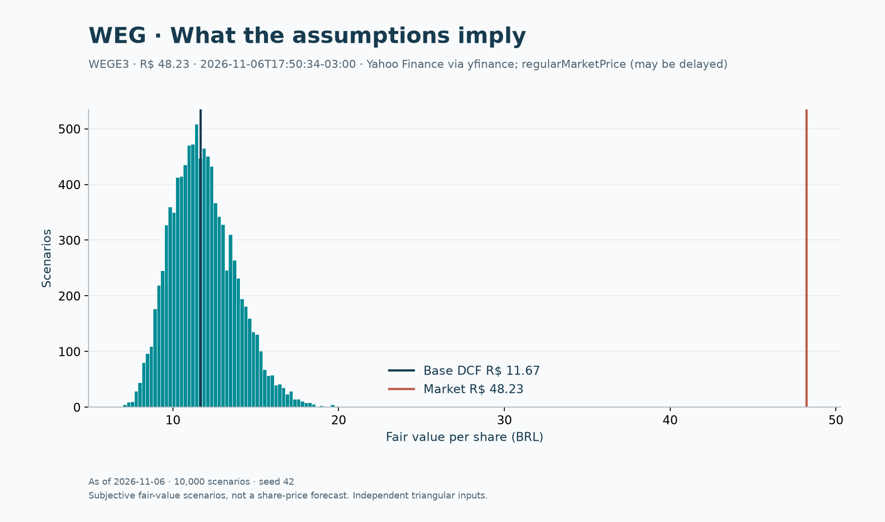
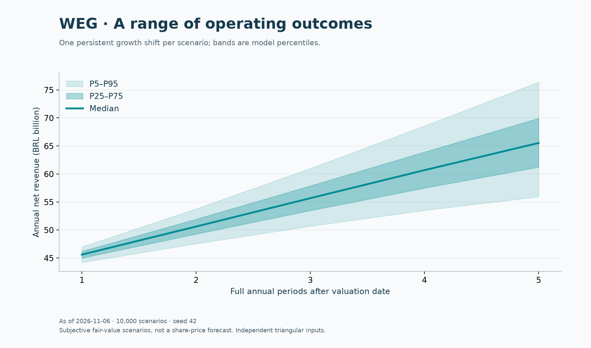
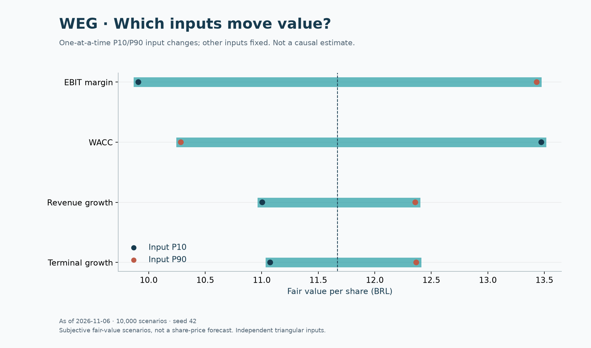
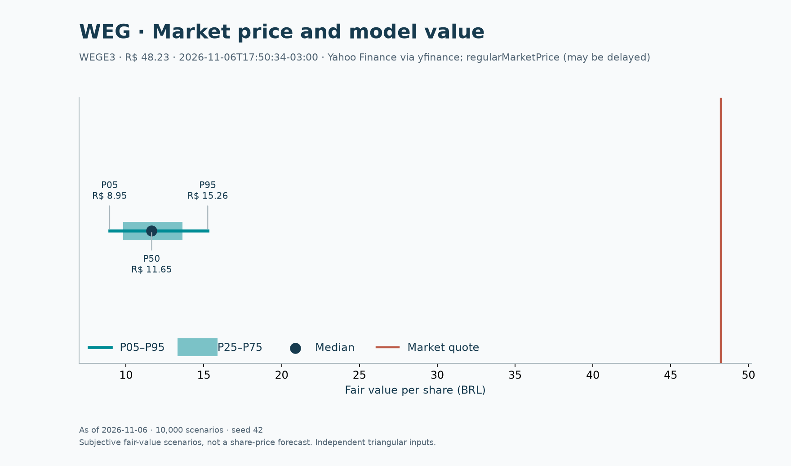

# B3 equity research toolkit in Python

[](https://github.com/VictorPimentaDev/dcf-valuation-model/actions/workflows/ci.yml)

**English summary:** Reproducible WEG (B3: WEGE3) research: a sourced stock pitch,
Brazilian industry analysis, formula-driven Excel DCF and seeded Monte Carlo on
revenue growth, EBIT margin, WACC and terminal growth. Offline fixtures, a Jupyter
notebook and four matplotlib figures make assumptions and results inspectable.

Estudo de **WEGE3**, com avaliação em **06/11/2026** e fundamentos TTM até
**30/09/2026**. A tese conecta equipamentos elétricos, reinvestimento e geração de
caixa. Os dados históricos vêm da CVM e do RI; projeções e distribuições são
**hipóteses do autor**, não guidance nem probabilidades calibradas de retorno.

| Resultado reproduzível · 10.000 cenários · seed 42 | R$/ação |
| --- | ---: |
| DCF base | **11,67** |
| Monte Carlo P5 / mediana / P95 | **8,95 / 11,65 / 15,26** |
| Cotação observada em 06/11/2026, 17:50:34 −03:00 | **48,23** |

A cotação foi coletada às 18:05:36 −03:00 via yfinance/Yahoo Finance, pode ter atraso
e não é apresentada como fechamento oficial. O spread base é −75,8%; a distância
mostra o que essas premissas não explicam. Não equivale a uma probabilidade de queda.
[Preço e metadados](src/dcf_valuation/data/weg_research.json) ·
[fonte da cotação](https://finance.yahoo.com/quote/WEGE3.SA/).

[](https://colab.research.google.com/github/VictorPimentaDev/dcf-valuation-model/blob/main/notebooks/weg_research.ipynb)

No Colab, envie o ZIP do código-fonte quando a primeira célula pedir. Enquanto o
repo for privado, abra o notebook com uma conta autorizada ou baixe o `.ipynb` e
use **Upload notebook** no Colab; não coloque tokens nas células.

## Ler e inspecionar

- [Stock pitch](docs/pitch.md), também em [HTML](docs/pitch.html).
- [Industry deep dive: equipamentos elétricos no Brasil](docs/industry-deep-dive.md).
- [Metodologia, distribuições e limitações](docs/methodology.md).
- [Notebook executado](notebooks/weg_research.ipynb).
- [Excel com oito abas](examples/weg-research.xlsx) e [resumo JSON](examples/weg-research.json).

## Reproduzir

Python 3.11 ou superior, na raiz do repositório:

```bash
python3 -m venv .venv
source .venv/bin/activate
python -m pip install -e '.[dev]'
dcf --output outputs/weg-research.xlsx --charts-dir outputs/charts --samples 10000 --seed 42
python scripts/reproduce.py
# Ou abra o notebook interativamente:
jupyter notebook notebooks/weg_research.ipynb
```

Os dois comandos de reprodução usam **somente fixtures locais**. O script executa
o notebook e salva `outputs/weg_research.executed.ipynb`; suas células geram Excel,
CSV das amostras e PNGs em `outputs/notebook/`. A CLI gera Excel, JSON e quatro PNGs.
Os destinos informados são sobrescritos. Nenhum token ou credencial é necessário.

Para buscar outra cotação, explicitamente:

```bash
dcf --live --output outputs/weg-live.xlsx --charts-dir outputs/live-charts
```

Falhas da consulta são explícitas; não há troca silenciosa por preço antigo. O modo
live **não atualiza fundamentos nem a data da avaliação**. Uma cotação muito posterior
à data-base exige atualizar a pesquisa antes de interpretar a comparação.

## Quatro visões dos mesmos cenários

O histograma mostra fair value, o fan chart mostra receita e o tornado altera um
driver por vez entre P10/P90. A comparação final mostra a cotação e os percentis
de fair value, não uma previsão da trajetória futura da ação.






## Premissas e Excel

Crescimento Y1–Y5: 12%, 11%, 10%, 9%, 8%. Margem EBIT 20%; WACC 14,652%; g 4%.
Monte Carlo: triangulares independentes, moda no caso base, amplitudes de ±5 pp
crescimento, ±4 pp margem, ±2,5 pp WACC e ±1,5 pp g. Choques de crescimento e margem
persistem por cinco anos. Capex, D&A, NWC, impostos e ponte patrimonial ficam fixos.
Os suportes são validados integralmente, incluindo WACC > g.

| Aba | Conteúdo |
| --- | --- |
| Assumptions | Drivers, taxas e ponte patrimonial editáveis |
| Historical | FY2024, FY2025 e TTM set/2026, claramente diferenciados |
| Projections | Cinco períodos de 12 meses desde a avaliação; receita até FCFF |
| DCF | Desconto, terminal, EV, equity e valor por ação |
| WACC | CAPM e estrutura-alvo de capital |
| Sensitivity | Grade WACC × g, redescontando todos os fluxos |
| Sources | Referências, unidades, datas e ressalvas |
| MonteCarlo | Seed, parâmetros, cotação, resumo e 10.000 amostras |

As sete primeiras abas têm fórmulas. `MonteCarlo` é um **snapshot calculado em Python**:
editar premissas marca a aba como desatualizada; execute a simulação novamente.
openpyxl não calcula caches das fórmulas. Abra no Excel/LibreOffice com recálculo
ativo; leitores de valores armazenados podem mostrar células vazias. A CLI e o
notebook calculam os resultados sem aplicativo de planilha.

Para mudar o cenário, salve um JSON e use `dcf --assumptions scenario.json`:

```json
{"growth": [0.10, 0.09, 0.08, 0.07, 0.06], "terminal_growth": 0.035}
```

Taxas são frações; drivers anuais exigem cinco valores. R$ milhões e milhões de
ações produzem R$/ação. Entradas inválidas são rejeitadas. Alterações no Excel não
reescrevem o JSON; a planilha não é protegida contra edição de fórmulas.

## Fontes, stack e verificação

[DFP 2025 CVM](https://dados.cvm.gov.br/dados/CIA_ABERTA/DOC/DFP/DADOS/dfp_cia_aberta_2025.zip)
+ [ITR 2026 CVM](https://dados.cvm.gov.br/dados/CIA_ABERTA/DOC/ITR/DADOS/itr_cia_aberta_2026.zip)
alimentam o TTM e a ponte de setembro. O
[fixture](src/dcf_valuation/data/weg_research.json) registra os hashes dos ZIPs;
[cvm_weg.csv](src/dcf_valuation/data/cvm_weg.csv) preserva as linhas usadas.
TTM = FY2025 + 9M2026 − 9M2025. O dataset retrospectivo de 2024 foi preservado.

Python, pandas, numpy, scipy, matplotlib, numpy-financial, yfinance, openpyxl e
Jupyter. O código compartilha o núcleo de cálculo entre DCF e cada cenário.

```bash
pytest -q
ruff check .
python -m build
```

CI em Python 3.11 e 3.13: lint, testes, pacote, geração de Excel/gráficos e execução
do notebook offline. Testes cobrem conta independente em Decimal, reconciliação
CVM, NPV, seeds, suporte dos drivers, fórmulas, cenário editado, PNGs e cotação.
Excel/LibreOffice nativo não foi executado; o arquivo também foi auditado em motor
independente de planilhas. Veja as limitações econômicas na metodologia.

Código sob [MIT](LICENSE). Dados CVM: atribuição à CVM e condições
[ODbL indicadas no catálogo](https://dados.cvm.gov.br/dataset/cia_aberta-doc-itr).
Documentos RI e dados de mercado mantêm as condições dos respectivos provedores.
Este material é educacional e não constitui recomendação de investimento.

Social preview: [imagem 1280×640 pronta](assets/social-preview.png). O primeiro
upload no GitHub fica para depois de tornar o repo público; a visibilidade segue privada.
