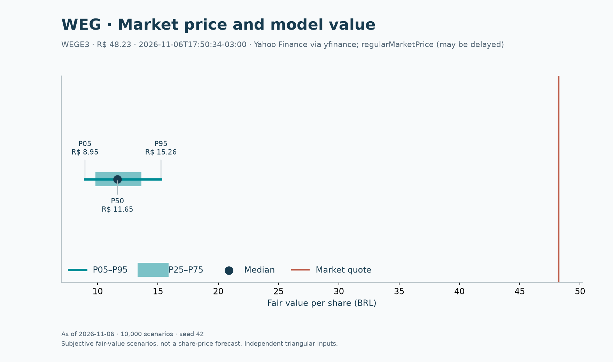

# WEG: a tese de qualidade precisa explicar o preço

**WEGE3 · B3 · avaliação em 06/11/2026 · Victor Pimenta**

Minha conclusão neste estudo é **cautela com o preço**: a operação pode ter vantagens
industriais, mas as hipóteses explicitadas aqui não sustentam a cotação observada.
O DCF base retorna **R$11,67/ação**, frente a **R$48,23** no snapshot de mercado.
Isso é um resultado condicional do modelo, não um preço-alvo de consenso nem uma
recomendação personalizada de investimento.

## A empresa e a hipótese de investimento

Escolhi a WEG porque motores, automação e equipamentos para geração, transmissão e
distribuição permitem conectar demanda, investimento em capacidade e capital de
giro ao caixa. Produtos de reposição e projetos de maior duração oferecem ciclos
diferentes. A presença internacional pode diversificar receita e também introduz
câmbio e execução industrial. A descrição dos negócios está no
[relatório da administração da DFP 2024, pp. 3–4](https://api.mziq.com/mzfilemanager/v2/d/50c1bd3e-8ac6-42d9-884f-b9d69f690602/f2b70b43-c767-ec6f-c3a5-a3da6aecf962?origin=1).

Minha hipótese é que eficiência energética e expansão de redes podem sustentar
pedidos, mas o retorno ao acionista depende do preço pago, da conversão de lucro
em caixa e do reinvestimento necessário. A diversificação, sozinha, não recebe um
prêmio automático no valuation.

## O que os dados mostram

| R$ milhões, exceto margem | FY2024 | FY2025 | TTM set/2026 |
| --- | ---: | ---: | ---: |
| Receita | 37.986,941 | 40.804,110 | 40.719,467 |
| EBIT | 7.690,528 | 7.998,741 | 7.884,487 |
| EBITDA = EBIT + D&A | 8.503,013 | 9.000,037 | 8.952,604 |
| Margem EBIT | 20,25% | 19,60% | 19,36% |

Fontes primárias: [DFP 2025 CVM](https://dados.cvm.gov.br/dados/CIA_ABERTA/DOC/DFP/DADOS/dfp_cia_aberta_2025.zip)
e [ITR 2026 CVM](https://dados.cvm.gov.br/dados/CIA_ABERTA/DOC/ITR/DADOS/itr_cia_aberta_2026.zip),
CNPJ 84.429.695/0001-11, versão 1. TTM = FY2025 + 9M2026 − 9M2025.
[Reconciliação, contas e unidades](methodology.md#fonte-unidade-e-reconciliação).
O TTM sobrepõe parte de FY2025; essa comparação não mede crescimento ano contra ano.

## Quanto as premissas sustentam

| Métrica | Resultado ou premissa |
| --- | ---: |
| Crescimento Y1–Y5 | 12%, 11%, 10%, 9%, 8% |
| Margem EBIT / imposto | 20% / 34% |
| Capex / D&A / NWC, sobre receita | 4,5% / 2,5% / 20% |
| WACC / g nominal BRL | 14,652% / 4,0% |
| Enterprise value | R$48.585,26 milhões |
| Equity value | R$48.967,86 milhões |
| Fair value base | **R$11,67/ação** |
| Cotação observada | **R$48,23/ação** |
| Spread base / cotação − 1 | **−75,8%** |
| Monte Carlo P5 / mediana / P95 | **R$8,95 / R$11,65 / R$15,26** |

Cotação: [Yahoo Finance, WEGE3.SA](https://finance.yahoo.com/quote/WEGE3.SA/),
`regularMarketPrice` capturado via yfinance. Horário de mercado **06/11/2026
17:50:34 −03:00**; coleta **18:05:36 −03:00**. Pode haver atraso; não é rotulada
como fechamento oficial. A avaliação usa os saldos patrimoniais de setembro sem
roll-forward do mês intermediário. O snapshot permanece reproduzível offline.

Os 10.000 cenários com seed 42 variam crescimento, margem, WACC e g em distribuições
triangulares explicitadas na [metodologia](methodology.md#monte-carlo-reproduzível).
Nenhum desses sorteios supera a cotação. Isso **não significa chance zero de alta**:
os suportes foram escolhidos pelo autor e excluem hipóteses mais otimistas e outros
riscos. A distância para o preço pede revisão das premissas e da estrutura do modelo,
não apenas mais simulações. Aproximadamente 64,6% do EV base vem do terminal.

## O que mudaria minha avaliação

A tese favorável exigiria crescimento persistente maior, margem superior, custo de
capital menor ou combinação desses fatores. Eu procuraria evidência de pedidos
convertidos em entregas, capacidade produtiva financiada e retorno incremental que
sustente a perpetuidade. Crescer receita sem financiar estoques, recebíveis e
fábricas não é uma hipótese econômica suficiente.

Catalisadores a acompanhar são divulgação de pedidos e resultados, entrada de
capacidade em operação e execução de projetos de rede. Eles podem alterar a
percepção sobre crescimento e margem; este estudo não atribui data ou probabilidade
a esses eventos. Uma redução de WACC sem melhora operacional também elevaria o DCF.

A tese adversa combina adiamento de encomendas, compressão de margem e capex antes
da receita. Isso pode afetar vários drivers simultaneamente, enquanto o Monte Carlo
padrão assume independência entre seus quatro sorteios. O [deep dive brasileiro](industry-deep-dive.md)
relaciona esses mecanismos ao ciclo setorial.

## Limites que pesam na conclusão

O modelo consolida negócios e países, não estima correlações empíricas e usa alíquota
uniforme de 34%. Capex, D&A e NWC fixos podem subestimar reinvestimento. O terminal
não tem ROIC próprio. O saldo contábil de não controladores aproxima seu valor justo;
arrendamentos são deduzidos como financiamento. Ações excluem tesouraria, sem previsão
de diluição ou recompras. Mudanças nessas escolhas podem alterar materialmente o valor.

Este pitch é auditável e reproduzível; não pretende encerrar a discussão sobre o
valor da WEG. O [notebook](../notebooks/weg_research.ipynb) permite alterar as
hipóteses, e o [Excel](../examples/weg-research.xlsx) mostra a conta por etapa.
